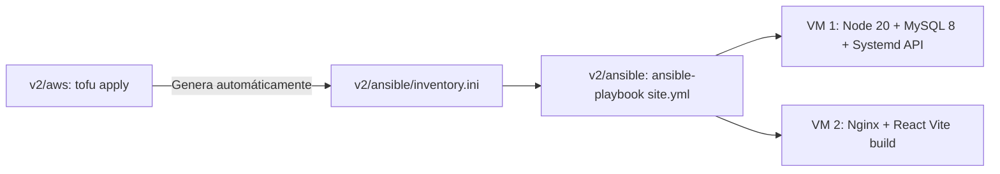

# Ansible — Módulo v2 (Sin Docker)

Este directorio contiene los playbooks para aprovisionar las máquinas virtuales de **AWS Ubuntu 24.04** creadas por OpenTofu en `v2/aws`.

---

## 🚀 Flujo Completo: OpenTofu + Ansible



---

## 1. Conexión y Permisos de la Llave SSH en WSL

Como la llave `.pem` se genera en Windows, antes de ejecutar Ansible desde WSL Ubuntu, cópiala o dale permisos:

```bash
mkdir -p ~/.ssh
cp ../aws/*-llave.pem ~/.ssh/asistencia.pem
chmod 400 ~/.ssh/asistencia.pem
```

---

## 2. Comandos Disponibles

Desde una terminal en WSL (o con `wsl -d Ubuntu`):

```bash
cd /mnt/c/Users/Usuario/Documents/m2/Mi-asistencia/v2/ansible
```

### Probar conectividad SSH (Ping):
```bash
ANSIBLE_HOST_KEY_CHECKING=False ansible-playbook ping.yml
```

### Desplegar todo el sistema (Backend + Frontend):
```bash
ANSIBLE_HOST_KEY_CHECKING=False ansible-playbook site.yml
```

### O desplegar por partes:
```bash
# Solo el backend (MySQL 8 + Node.js 20 + Systemd service)
ANSIBLE_HOST_KEY_CHECKING=False ansible-playbook playbook-backend.yml

# Solo el frontend (Nginx + Build React SPA con reverse proxy /api/)
ANSIBLE_HOST_KEY_CHECKING=False ansible-playbook playbook-frontend.yml
```
