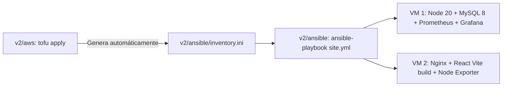

# Ansible — Módulo v2 (Sin Docker)

Este directorio contiene los playbooks para aprovisionar las máquinas virtuales de **AWS Ubuntu 24.04** creadas por OpenTofu en `v2/aws`, incluyendo la pila completa de observabilidad (Prometheus + Grafana).

---

## 🚀 Flujo Completo: OpenTofu + Ansible + Observabilidad



---

## 1. Conexión y Permisos de la Llave SSH en WSL

Como la llave `.pem` se genera en Windows, antes de ejecutar Ansible desde WSL Ubuntu, cópiala o dale permisos:

```bash
mkdir -p ~/.ssh
rm -f ~/.ssh/asistencia-llave.pem
cp /mnt/c/Users/Usuario/Documents/m2/Mi-asistencia/v2/aws/*-llave.pem ~/.ssh/asistencia-llave.pem
chmod 400 ~/.ssh/asistencia-llave.pem
```

---

## 2. Comandos de Despliegue

Desde tu terminal de WSL:

```bash
cd /mnt/c/Users/Usuario/Documents/m2/Mi-asistencia/v2/ansible
```

### Probar conectividad SSH (Ping):
```bash
ANSIBLE_HOST_KEY_CHECKING=False ansible-playbook -i inventory.ini ping.yml
```

### Desplegar todo el stack (Apps + Monitoreo):
```bash
ANSIBLE_HOST_KEY_CHECKING=False ansible-playbook -i inventory.ini site.yml
```

### O ejecutar solo la observabilidad:
```bash
# Instala Node Exporter en Backend y Frontend (puerto 9100)
ANSIBLE_HOST_KEY_CHECKING=False ansible-playbook -i inventory.ini playbook-node-exporter.yml

# Instala y configura Prometheus (9090) y Grafana (3000)
ANSIBLE_HOST_KEY_CHECKING=False ansible-playbook -i inventory.ini playbook-monitoring.yml
```

---

## 3. URLs de Acceso tras el despliegue

- **Grafana:** `http://<IP_BACKEND>:3000` (Usuario inicial: `admin` / `admin`)
- **Prometheus:** `http://<IP_BACKEND>:9090` (Targets en: `http://<IP_BACKEND>:9090/targets`)
- **Node Exporter Backend:** `http://<IP_BACKEND>:9100/metrics`
- **Node Exporter Frontend:** `http://<IP_FRONTEND>:9100/metrics`
